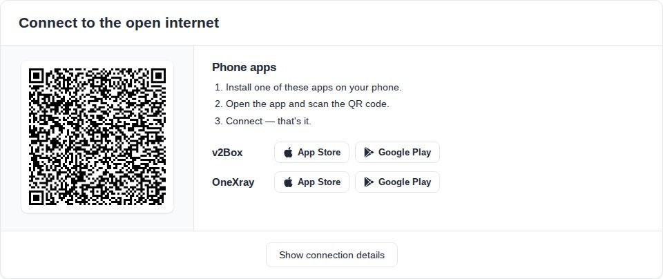
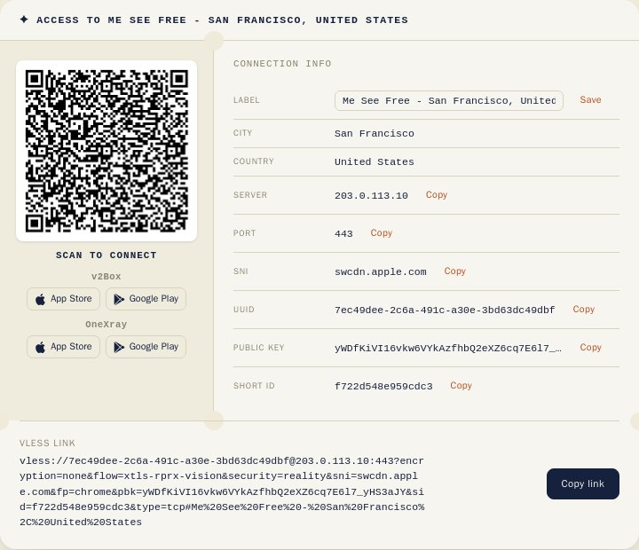

# Me See Free

## Family-friendly uncensored internet

Be ahead of upcoming regulation blocking VPN usage in the European Union, by scanning a QR code with your phone.



Me See Free is your own private VPN, completely under your control.

China's Great Firewall is 30 years ahead of the European Union at blocking the internet — and it still can't stop people reaching the open internet. Every time regulators block a way to access the internet, people find a new way.

Europe is following the same playbook. The UK's Online Safety Act already restricts access by identity and location, and the European Union is moving toward similar rules. And that is only the first step: specific sites are blocked first to "protect the children", then internet providers are pressured into blocking the VPNs people use to get around that.

- **Easy access** — Install a VPN app on your phone and scan the QR code — you're connected. No settings to type in.
- **Family Friendly** — When VPNs get blocked, people move to Tor — already happening in the UK. Tor also carries a lot of illegal activity alongside it. Me See Free also is not using Tor, on a server only you control.
- **Battle-hardened** — China's Great Firewall is 30 years ahead of the European Union on this, but still can't stop Me See Free as of 2026 — you're ahead of anything regulators in Europe have even tried yet.
- **Skip the age verification checks** — France and the UK now require age verification just to open many websites. Me See Free bypasses this, by moving your internet access from your home to an uncensored location.
- **Remove dependency on VPN** — As people will start VPNs to bypass age verification, regulators will push to internet providers to block VPNs. Me See Free is made to bypass these blocks by disguising the connection to your VPN as normal internet traffic, making it hard to detect by the deep packet inspection used by internet providers and regulators.

## How it works

The latest Chinese anti-censorship technology uses **REALITY**. REALITY disguises your connection as an ordinary visit to a trusted site (e.g. the regulator's own servers), indistinguishable from millions of other people visiting that same site. There's nothing fake to notice and no unusual pattern to flag — which is why it holds up where earlier VPN protocols get detected and blocked. As of 2026, REALITY still works in China. You never actually connect to or use the camouflage domain — it's disguise only, not a real destination for your traffic.

Me See Free runs a private VLESS+REALITY proxy on a server you control, disguising your connection as an ordinary visit to a trusted website so it can't be detected or blocked. The portal generates a unique identity and keypair on first start and gives you a ready-to-scan QR code and connection link — no manual networking configuration required.

Your device connects to your own server on port 443 — the same port every HTTPS website uses. REALITY makes that connection indistinguishable from an ordinary visit to a real, trusted site: no fake certificate, no unusual pattern, nothing to fingerprint. Only someone holding your private key can actually reach the proxy hiding behind that disguise.



*Sample screenshot with fake data — this connection will not work. Your own portal will show real, working connection details.*

## Credits

Me See Free doesn't implement a proxy protocol of its own — it's a setup and management layer around two existing open source projects:

- **[V2Ray](https://github.com/v2fly/v2ray-core)** (Project V), started in 2015 by a developer known as Victoria Raymond.
- **[Xray-core](https://github.com/XTLS/Xray-core)** (Project X), the actively maintained fork this stack actually runs, created and maintained by **RPRX** — also the author of VLESS, XTLS, and REALITY.

What Me See Free adds on top: automatic identity/keypair generation, HTTPS with Let's Encrypt, a status portal with QR code, and a 15-minute deployment — making Xray-core easy to set up and manage instead of hand-configuring it yourself.

This project is free and open source — self-hosted, no subscription, no accounts, and the code is yours to inspect.

## Installation

Setup can be done within 15 minutes.

1. **Source the VPS.** Spin up a small cloud server at a provider of your choice (e.g. Vultr, DigitalOcean), in a jurisdiction without internet censorship. The cheapest tier is enough.

2. **Test the ping.** Before doing anything else, go back to your home connection, switch off any VPN, and ping the VPS's IP address:
   ```
   ping <VPS_IP>
   ```
   If the ping fails or times out, your internet provider is likely already blocking that IP range. Go back to your provider, request a new IP (or destroy and recreate the VPS), and test again. If it keeps failing, try a different provider or region entirely. Don't proceed to the next step until this succeeds.

3. **Install Docker** on the VPS, in one go with Docker's official install script:
   ```
   curl -fsSL https://get.docker.com | sh
   ```

4. **Download `docker-compose.yaml` and `.env`** into a folder on your VPS:
   ```
   curl -O https://raw.githubusercontent.com/jeltechnologies/meseefree/main/docker-compose.yaml
   curl -o .env https://raw.githubusercontent.com/jeltechnologies/meseefree/main/.env.example
   ```
   `.env` is the file you'll actually edit in the next step — it's gitignored so your real
   credentials never end up in any repo.

5. **Set initial portal credentials.** Open `.env` and fill in `PORTAL_USER_NAME` and `PORTAL_PASSWORD` —
   the portal refuses to show your connection details until both are set. These are only used for your
   very first sign-in: the portal then asks you to choose your own username and password, stores the
   password as a salted hash (never in plain text), and ignores the `.env` values from then on.

6. **(Optional) Point a domain at it for a trusted HTTPS certificate.** The portal is HTTPS-only and
   works out of the box with a self-signed certificate. Browsers can't issue a trusted certificate for
   a bare IP address, so if you open the portal via `https://<VPS_IP>:16810` you'll always get a
   warning about the self-signed certificate — this is completely normal and not a sign anything is
   wrong, just click past it. If you'd rather not see that warning at all, point a domain's DNS A/AAAA
   record at your VPS's IP and set `DOMAIN` in `.env`; the stack then automatically obtains and renews
   a real certificate from Let's Encrypt (this needs port 80 reachable from the internet, which the
   stack already publishes for you).

7. **Run it:**
   ```
   docker compose up -d
   ```
   On first start, the stack automatically generates a unique client identity, REALITY keypair, and
   TLS certificate — no manual configuration required beyond the portal credentials above.

8. **Open the portal.** In a browser, go to:
   ```
   https://<VPS_IP>:16810
   ```
   (or `https://<DOMAIN>:16810` if you set one in step 6). Without a configured `DOMAIN`, your browser
   will warn about the self-signed certificate — that's expected and safe to click through, it's just
   how browsers react to any IP-address URL, not a sign of a problem with your setup. Log in with the
   `PORTAL_USER_NAME`/`PORTAL_PASSWORD` you set in step 5, then choose your own username and password
   when prompted. You can change them again later via **Change login** at the bottom of the page. If
   you ever forget them, delete `data/tls/portal-credentials.properties` and restart the portal
   (`docker compose restart portal`) to sign in with the `.env` credentials again.
